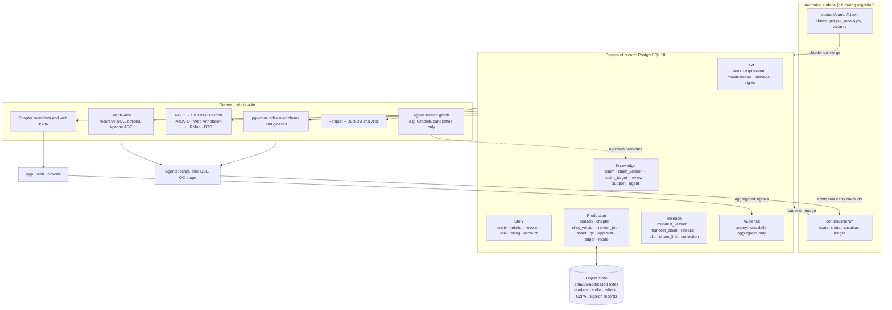
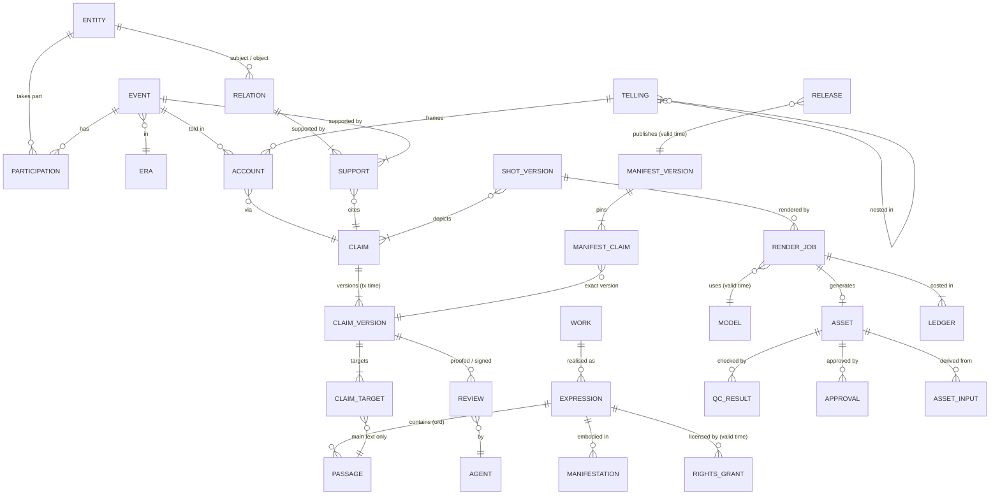

# Dheevara data architecture: the temporal knowledge graph

Status: proposal, 15 Oct 2026. Not yet adopted; decisions marked **Decide** need Avi.
Inputs: `research_notes/Open source stack for Dheevara/` (`repo_product_and_data_state.md` §E, `temporal_knowledge_graph_storage.md`, `code_generated_video.md`, `orchestration_serving_infra.md`, `image_consistency_qc.md`). Schemas were checked against `origin/claude/m6-web` (`schema/*.json`, `content/**`) and `origin/claude/app-a2-ui` (`apps/dheevara/shared/core/.../manifest/ChapterManifest.kt`).

The founder's question was: "the architecture in terms of the data that we need to store, out of which we can build that temporal knowledge graph." The short answer:

- **One system of record: PostgreSQL 18.** It holds six layers: text, story, knowledge, production, release and audience aggregates. The knowledge layer is versioned with bitemporal keys (`WITHOUT OVERLAPS`), and its history is append-only.
- **One content-addressed object store** (S3-compatible, keys `sha256/…`) for every byte that is not a row: renders, audio, reliefs, C2PA manifests and signed sign-off records.
- **Everything else is a projection that can be rebuilt.** That covers chapter manifests, web JSON, the graph view, the RDF/JSON-LD export, the DTS endpoint, vector indexes, analytics files and any LLM scratch graph.
- **Git stays the authoring surface** until the database takes over each kind of write, one phase at a time (§7).
- **The rule that makes it a knowledge graph and not just a database:** a story fact reaches the text only through a registered claim, and a claim reaches the text only through main-text passages. Star passages, popular tellings and LLM extractions all have their own types, and none of them can be cited as the text.

---

## 1. Why a temporal graph

Today, the "canon graph" is two JSON files: claims, and people with embedded edges. Time appears only in prose: "day 13", "sunset" in a shot's `setting`, and a proof status with no timestamp or actor (§E.18–E.19 of the repo notes). That is enough to build one chapter. It cannot answer the questions the product promises: the citation trail, scholar sign-off, corrections, re-renders and release history. These are the questions the data must answer, and the time axes each one needs:

| # | Question | Axes needed | Answered by (§4) |
|---|---|---|---|
| Q1 | What did viewers of s1e3 see about Jayadratha's boon on release day, and which verse backs it? | release, knowledge, text | `pub.release` → `pub.manifest_claim` → pinned `kn.claim_version` → `kn.claim_target` → `txt.passage` |
| Q2 | Every event involving Abhimanyu before day 13, with the narrator frame | story, text | `story.participation`, `story.event` (era and war-day ticks), `story.account`, recursive `story.telling` |
| Q3 | Which shots must re-render, and which manifests and releases are affected, if claim X is corrected? | knowledge, production, release | `prod.shot_claim`, `prod.line_claim` → `prod.render_job` → `prod.asset_input` (recursive) → `pub.manifest_version` |
| Q4 | Who signed off this claim, when, and is that sign-off still valid? | knowledge | `kn.review` pinned to `(claim_id, version)` |
| Q5 | How much did this chapter cost, per shot? | production | `prod.ledger` |
| Q6 | Which claims changed after a chapter shipped, and what correction notice is owed? | knowledge, release | claim versions whose `tx_period` starts after `pub.manifest_version.graph_as_of` |
| Q7 | Is the s1e3 reveal's popular tier attributed to a telling and never to the text? Does the womb story have a manuscript foothold (*259)? | text | `txt.expression.kind`, `kn.apparatus_note` |
| Q8 | Which verses may we show in which territory, under which permission, today? | text, release | `txt.rights_grant` (valid time) against `pub.release.available` |
| Q9 | Which model, seed, licence and territory produced this frame, and did QC pass it? | production | `prod.asset` ← `prod.render_job` → `prod.model` (valid-time prices and terms), `prod.qc_result` |
| Q10 | Where did viewers drop in s1e3 version 4, by shot, and did the reveal hold them? | release, audience | `aud.segment_daily` (aggregates only) |

Questions Q1, Q3, Q4 and Q6 together are the moat statement in data form: "the graph with a citation on every claim". Without the time axes, Dheevara could say what it believes now. It could not say what it showed, when, on whose authority, or what has to change.

---

## 2. The four time axes

These four axes are independent and must never share a column. The most common mistake would be to store story time in a bitemporal "valid time" column. Story time is not a real-world timeline. It is in-world, often only partially ordered, contested between tellings, and itself a claim that needs a citation.

| Axis | What it orders | Unit and representation | Who sets it | Example |
|---|---|---|---|---|
| **Story time** | Events inside the narrative | Eras (ordinal) plus a per-work story clock (`int4range` of ticks) plus a partial order (`story.event_order`), all qualified by telling | Editors, from claims | Abhimanyu enters the array: era `mbh.war`, day 13, morning |
| **Textual time** | Works, editions, manuscripts and retellings; and position inside a text | LRMoo work → expression → manifestation; `passage.ord` within an expression; dated expressions | Ingest, from sources | `bori-ce` 7.34.19 is at ord *n*; `*259` lives in `bori-ce-app` |
| **Knowledge (system) time** | What Dheevara asserted, verified or corrected, and when | Bitemporal: `tx_period` (when recorded) on every version row; `valid`/`available` (when it applied in the world) where the world has a period | The database (tx), people (valid) | Claim `mbh.7.32.12` v1 said "c. v.13"; v2 was recorded 4 Oct 2026 |
| **Release (viewer) time** | What was published, where, in which language, when, and which manifest version was live | `pub.release.available tstzrange` (valid time) × `tx_period`; local release rule (19:00 viewer time) | Publishing workflow | s1e3 v4 live worldwide in the app from 19:00 UTC+14 on the release date |

### 2.1 Story time

Story time has three parts.

1. **Era.** Every event belongs to one era of its work. Eras have an integer order (`story.era.ord`). Mahābhārata eras might be: `mbh.ancestry` < `mbh.youth` < `mbh.dice` < `mbh.exile` < `mbh.incognito` < `mbh.embassy` < `mbh.war` < `mbh.after`. The list is a scholar decision; these names are placeholders. An era is the coarsest statement that can still be cited.
2. **Story clock.** Inside an era that has a known calendar, events get an `int4range` of ticks. For the Kurukṣetra war the clock is `day × phase`, with six phases per day: `dawn, morning, midday, afternoon, sunset, night`. So `tick(d, p) = (d−1)·6 + p`, and day 13 is `[72, 78)`. This turns "time of day follows the text" (style bible §5) and the shot `setting` prose (dawn → sunset across sh01–sh13) into data. The other calendars are clocks of the same kind: the 13 years of exile (`exile.year`), and the Rāmāyaṇa's timeline in Laṅkā when a season needs it.
3. **Partial order.** Many events cannot be placed on a clock, only before or after another event. `story.event_order(before_id, after_id)` stores these edges. Queries take the transitive closure, and a loader check rejects cycles.

Two qualifiers make story time honest:

- **Placement is a fact and needs support.** "Abhimanyu enters on day 13, morning" must cite claims (`kn.support` with `role = 'dates'`). If a placement cannot be cited it is left out, and the event stays in its era with `clock_span = NULL`.
- **Placement can depend on the telling.** A telling (§2.1.1) may place or order events differently. A placement row carries `telling_id`; `NULL` means "as the main text gives it".

#### 2.1.1 Narration frames (tellings)

The epics are nested narrations, and the witness rule depends on them: Sañjaya is both a character and the narrator of the war. A **telling** is a reified narration act:

| Telling id | Narrator → addressee | Inside | Where it happens |
|---|---|---|---|
| `tell.mbh.ugrashravas-shaunaka` | Ugraśravas → Śaunaka and the sages | (outermost) | Naimiṣa forest |
| `tell.mbh.vaishampayana-janamejaya` | Vaiśampāyana → Janamejaya | `tell.mbh.ugrashravas-shaunaka` | Janamejaya's snake sacrifice |
| `tell.mbh.sanjaya-dhritarashtra` | Sañjaya → Dhṛtarāṣṭra | `tell.mbh.vaishampayana-janamejaya` | Hastināpura, during the war |
| `tell.ram.lava-kusha-rama` | Lava and Kuśa → Rāma | (outermost, Bālakāṇḍa frame) | Rāma's court |
| `tell.dm.markandeya-kraushtuki` | Mārkaṇḍeya → Krauṣṭuki | (outermost) | Mārkaṇḍeya Purāṇa |
| `tell.dm.medhas-suratha` | Medhas → Suratha and Samādhi | `tell.dm.markandeya-kraushtuki` | Medhas' hermitage |

Each telling has its own story moment (`told_during`, an event). This is why text order is not story order. In the Droṇaparvan, Sañjaya reports Droṇa's fall early and then narrates the days that led to it (passage refs to confirm with the scholar). And 7.41 *retells* Śiva's boon to Jayadratha, an exile-era event first told at 3.256. `story.account(event, telling, claim, mode)` records each of these, with `mode` one of `narrated | recalled | foretold | retold`. Witnesses are the product's version of this structure: `sanjaya` is a telling's narrator; `vanara` and the Devī season's listeners are viewpoints inside a frame. The witness allowlist becomes "entities with `can_witness = true`" rather than an enum kept in three places.

### 2.2 Textual time

Textual time follows LRMoo:

- **Work** (LRMoo F1). The Mahābhārata as an abstract work: `mbh`, `ram`, `markp` (Devī Māhātmya is a section of the Mārkaṇḍeya Purāṇa; how to identify it is an open question, §7.4).
- **Expression** (F2). A specific text of a work:
  - `bori-ce` is the constituted critical text, and the only `main_text` expression of `mbh`.
  - `bori-ce-app` is the BORI critical apparatus, where star passages live.
  - Others: `baroda-ce`; vulgate (`mbh-vulgate-nk`, Nīlakaṇṭha); regional recensions; individual manuscripts (`ms.K1`) when a variant needs one; translations (`ganguli-en`, cited by Ganguli's own section numbers, never as CE verses).
  - Popular tellings (`pop.*`: a kathā tradition, a TV serial, a film, Amar Chitra Kathā) are also expressions. Each has a medium and a date.
- **Manifestation** (F3). A printed volume (`bori-ce.vol07-1958`, ed. S. K. De), an e-text file pinned by sha256 (`gretil-mbh.07`, `smith-ud.MBh07`), or a scan set (IIIF, later).
- **Item** (F5). A physical copy, e.g. "the BORI Droṇaparvan on Avi's shelf". This is needed only once scans and page coordinates exist (DHE-22).

Inside an expression, **position** is `passage.ord`, a dense integer in reading order. Verse ranges and whole-adhyāya claims then become integer ranges. `mbh.14.65-69` becomes `[ord(14.65.1), ord(14.69.last)]`, so the adhyāya range is never lost again (it is lost today in the manifest, gap E.19.5).

Dates on expressions are as precise as the sources allow. They are stored as EDTF strings (`1933/1966`, `1958`, `1988/1990`), never invented. The composition date of the epic is not modeled; that is scholarship, not data.

### 2.3 Knowledge (system) time: bitemporal

Two time dimensions are stored separately:

- **Transaction time (`tx_period`)**: when a row was the database's current belief. It is set by the database, never edited, and closed (never deleted) when a new version supersedes the row. PostgreSQL has no system-versioned tables, so a trigger maintains it (§4.3).
- **Valid time (`valid` or `available`)**: when something applied in the world outside the database. Only some things have it:
  - model prices and terms (`prod.model.valid`), because fal changes prices;
  - rights grants (`txt.rights_grant.valid`), because the 1958 Droṇaparvan may leave copyright in 2028 or 2038;
  - release availability (`pub.release.available`);
  - a scholar's appointment (`kn.agent_role.valid`).

Claims carry **transaction time only**. A claim is Dheevara's reading of a passage. It does not "become true" on a date; we come to hold it, revise it or withdraw it. A correction is a new version: v2 of `mbh.7.32.12` records that the vow is at 7.32.12 and not "c. v.13". "What did we believe on 4 Oct at 10:00?" is `tx_period @> '2026-10-04 10:00Z'`.

Verification is a separate stream of PROV activities (`kn.review`), each pinned to an exact claim version. It has two times: when the scholar did it (`at`) and when we recorded it (`recorded_at`). The status ladder `etext → proofed → signed` is **derived**: a version is `signed` if a sign-off on that exact version exists and has not been withdrawn. Editing the statement makes a new version, and that automatically drops it back to `etext` until it is signed again. This is how rule 9 ("scholar sign-off before anything is public, stored as a record") becomes mechanical.

Story-layer facts (events, relations, placements) change less often and are not shown to viewers directly. They get transaction-time history through a generic history table written by trigger (`kn.history`, the classic `temporal_tables` pattern). Using a generic table instead of per-table temporal keys keeps foreign keys simple.

### 2.4 Release (viewer) time

What a viewer saw is fixed by three things:

1. **The manifest version** they were served. It is an immutable projection, `s1e3@4`, with its content hash and `graph_as_of` (the transaction time the generator read).
2. **The release row** that made that version live: channel (`app | web | shorts | reels | whatsapp | partner`), territory, locales, and the **local release rule**. "19:00 in the viewer's zone" is a date plus a local time, not a single instant. `available` stores its envelope: lower bound 19:00 at UTC+14, then each zone in turn. The app still computes the local instant (`Release(date, 19:00)` in `Entitlements.kt`). Today no release date exists anywhere in content (gap D.9.12); this fixes it.
3. **The claim versions pinned** in that manifest (`pub.manifest_claim.version`). Because the manifest pins versions, "what viewers saw" does not depend on reconstructing transaction time. The pin and the transaction-time `as of` must agree, and the loader checks that they do.

A correction therefore never rewrites history. It creates a new manifest version and a new `available` period on the same release, and the old period stays queryable. The 3-hour takedown rule (IT Rules 2026) is a release row whose `available` ends at the takedown instant, with the reason recorded.

---

## 3. Entity model

### 3.1 Layers



### 3.2 Core entity relations



### 3.3 Node and edge types by layer

Identifiers are human-readable wherever they already are, and content hashes wherever the thing is bytes. The global URI form for export is `https://id.dheevara.app/<type>/<id>`. That domain is a proposal (**Decide**); nothing resolves there yet.

#### Text layer

| Type | Id form (examples) | Key fields | Maps to |
|---|---|---|---|
| Work | `mbh`, `ram`, `markp` | title, Wikidata QID | LRMoo F1 Work; schema.org `Book` |
| Expression | `bori-ce`, `bori-ce-app`, `baroda-ce`, `ganguli-en`, `pop.tv-1988` | kind (`critical_text, base_text, apparatus, vulgate, regional_recension, manuscript, translation, popular`), `main_text`, `shown_as`, EDTF date | LRMoo F2 Expression; DTS Resource |
| Manifestation | `gretil-mbh.07`, `smith-ud.MBh07`, `bori-ce.vol07-1958` | kind, uri, **sha256**, retrieved, licence note | LRMoo F3; schema.org `PublicationVolume` |
| Passage (verse) | `mbh.7.34.19` = `bori-ce` / `7.34.19` | ord, book, adhyāya, verse, Devanagari, IAST, `data_class` | DTS citable unit; TEI `<l>`/`<lg n>`; CTS-style URN on export |
| Verse range | not a node: `[from_ref, to_ref]` inside one expression, stored as `int4range` of ord | — | Web Annotation `RangeSelector`; DTS `start`/`end` |
| Star passage | `mbh.7.34.18*259` in `bori-ce-app` | `after_ref`, witnesses (`K1`, `K2`), `main_text = false` | TEI `<app>/<rdg wit>`; LRMoo F2 (apparatus) |
| Apparatus note | `mbh.7.34.18*259` | approved wording ("The critical edition's text does not tell it; some manuscripts do (*259)"), review | Web Annotation, motivation `commenting` |
| Rights grant | `rg.bori.etext.2026` | expression, territory, `valid daterange`, terms, evidence asset | ODRL `Permission` (export) |

#### Story layer

| Type | Id form | Key fields | Maps to |
|---|---|---|---|
| Entity: person, being, group, class | `abhimanyu`, `sanjaya`, `samshaptakas`, `vanara` (a **class**, not a person) | names (`sa`, `en`, regional), `revered`, `can_witness`, QID | CIDOC E21 Person / E74 Group; SEM Actor; Wikidata |
| Entity: place | `kurukshetra`, `hastinapura`, `mahendra` | names, optional coordinates (only where the text supports them) | CIDOC E53 Place; SEM Place |
| Entity: object, weapon, formation | `chariot_wheel`, `gandiva`, `chakravyuha` | names, kind | CIDOC E22 Human-Made Object; E29 Design (formation) |
| Era | `mbh.war` | ord | OWL-Time ordinal TRS |
| Event | `ev.mbh.abhimanyu-enters-vyuha` | kind, era, `clock_span`, place, `part_of` | CIDOC E5 Event; SEM Event; OWL-Time interval |
| Participation (edge) | `(event, entity, role)` | role: `agent, patient, giver, recipient, witness, instrument` | SEM `hasActor` + role; CIDOC P11 |
| Relation (edge) | `abhimanyu.student_of.arjuna` | `rel` (controlled vocabulary with inverse), era/`clock_span` from which it holds, `via_event`, telling | CIDOC P107/P152; Wikidata P22/P25/P26/P1066 where they exist |
| Event order (edge) | `(before, after)` | — | OWL-Time `before` |
| Telling | `tell.mbh.sanjaya-dhritarashtra` | narrator, addressee, `parent_telling`, `told_during` | SEM "view" / CIDOC E7 Activity |
| Account (edge) | `(event, telling, claim, mode)` | `narrated, recalled, foretold, retold` | SEM `accordingTo` |
| Reference | `char.abhimanyu`, `loc.kurukshetra`, `obj.chariot`, `style.relief_basalt_lamp` | `depicts` entity, current asset set | Resolves today's dangling shot `references` (E.10) |

The relation vocabulary is fixed in `story.rel_type`, snake_case, each with an inverse: `child_of ↔ parent_of`, `student_of ↔ teacher_of`, `spouse_of` (symmetric), `killed_by ↔ killed`, `boon_from ↔ granted_boon_to`, `saved_by ↔ saved`, `asked_by ↔ asked`. Only one direction is stored. Inverses are generated in views and in the manifest, which fixes "`parent_of` appears once, `child_of` five times" (E.6). A relation that results from an event (`killed_by`) points to the event (`via_event`), so it gets the event's day and frame.

#### Knowledge layer

| Type | Id form | Key fields | Maps to |
|---|---|---|---|
| Claim | `mbh.7.34.19`, `mbh.14.65-69`, `ram.5.1.75-79`; second statement on the same target: `mbh.3.256.25-28~limit` | work, created | Web Annotation `oa:Annotation` (identity) |
| Claim version | `mbh.7.32.12@2` | statement, translation and by, flags, change note, `tx_period`, `derived_from` (git sha) | PROV Entity, `prov:wasRevisionOf` |
| Claim target (evidence link) | `(claim@v, expression, from_ref, to_ref)` | main-text only (§4.4) | Web Annotation target + `RangeSelector` (motivation `describing`) |
| Support (edge) | `(fact_kind, fact_id, claim)` | role: `states, implies, retells, dates` | PROV `wasDerivedFrom` (fact ← claim) |
| Review / sign-off | `rv.1042` | verdict (`proofed, signed, flagged, withdrawn`), agent, `at`, `recorded_at`, method ("printed vol. 7 p. …", "double-keyed"), signed record (asset hash) | PROV Activity, `wasAssociatedWith`, `generatedAtTime` |
| Agent | `person:avi-solanki`, `scholar:<slug>`, `sw:canon-loader@<sha>`, `model:qwen3-vl-8b@<hash>` | kind, display, roles over valid time | PROV Agent (Person, SoftwareAgent) |
| Popular attestation | `pa.who-taught-him.womb` | statement, popular expressions, url, retrieved | Web Annotation, motivation `commenting`; never a claim |

**Claim identity.** Decision 24 made a claim's id its primary passage reference, and every manifest, caption and contract already uses those ids. This design keeps them. If two different statements are ever needed about the same passage, the second gets a suffix (`~slug`), an additive extension of the id pattern. A claim's target can change between versions (that is what a verse-number correction is), and the id still reads as the first target. When the two diverge, the loader warns, and the fix is a new claim with a correct id plus a `superseded_by` link.

#### Production layer

| Type | Id form | Key fields | Maps to |
|---|---|---|---|
| Season | `mbh-s1` | work, edition (expression), title | schema.org `CreativeWorkSeason` |
| Chapter | `s1e3` | season, ord, title, witness entity | schema.org `Episode` |
| Beat | `s1e3.b3` (kind `scene`) | kind, `start_ms`, `end_ms`, verse claim, reveal | OTIO `Stack`/`Track` region |
| Shot | `s1e3-sh05` | chapter, beat, ord | OTIO `Clip` |
| Shot contract version | `s1e3-sh05@sha256:<hex>` | contract JSON (today's schema), `tx_period` | PROV Entity |
| Scene code / shot DSL | `scene:sha256:<hex>` | DSL text (YAML/JSON), compiler version | PROV Plan; the source of truth for the code-generated path |
| Prompt / payload | `payload:sha256:<hex>` | compiled provider payload (deterministic) | PROV Entity |
| Narration line | `s1e3.n12` versions | text per language, claims | — |
| Model | `kling-v3-standard-t2v` over `valid` | endpoint, licence, territory, trains-on-inputs, USD/s | PROV SoftwareAgent; `src/render/models.mjs` today |
| Render job | `render:s1e3-sh05:1` (today's idempotency key) | contract hash, model, seed, quality, `input_hash`, status | PROV Activity |
| Asset | `sha256:<hex>` | media type, bytes, kind, territory, C2PA manifest, watermark id | PROV Entity; C2PA asset; schema.org `MediaObject` |
| QC result | `qc.<id>` | asset, check, verdict, judge (model or person), frames, `fix_hint` | PROV Activity |
| Approval | `ap.<id>` | subject, decision, **human** agent, `at` | PROV Activity (rule 6) |
| Ledger entry | `(run, key, phase)` | every provider call: est and actual USD, FX, request id | — (append-only event log) |
| Provenance manifest | asset of kind `c2pa_manifest` | c2pa-rs signed JSON, `trainedAlgorithmicMedia`, model and LoRA versions, watermark soft binding | C2PA 2.x |

The **content hash of a render input** follows `code_generated_video.md` §6: `sha256(scene DSL ‖ compiler@git-sha ‖ asset hashes ‖ renderer or model version ‖ locale ‖ aspect)`. The same hash is the cache key, the provider idempotency key and the ledger reservation key (`orchestration_serving_infra.md` §1). So a retried activity never bills twice, and a changed claim invalidates exactly the shots whose inputs it reached.

#### Release layer

| Type | Id form | Key fields | Maps to |
|---|---|---|---|
| Manifest version | `s1e3@4` | schema version, body, **sha256**, `graph_as_of`, generator git sha | schema.org `Episode` (as published); PROV Entity |
| Manifest claim use | `(manifest, claim@v, used_in, locator)` | the words shown, per language | Web Annotation (caption → claim) |
| Release | `rel.s1e3.app.ww` over `available` | channel, territory, locales, local date and time | schema.org `PublicationEvent` |
| Locale | BCP-47: `en`, `hi`, `ta`, `sa`; voice locale `en-IN` | — | BCP-47 |
| Clip | `clip:sha256:<hex>` | chapter, reveal, manifest version, burned-in label | schema.org `Clip` |
| Share link | token (≤ 64 chars) | chapter, reveal, manifest version at share time; **no person** | — |
| Correction | `cx.<id>` | claim, from version, to version, manifests affected, notice text | PROV `wasInvalidatedBy` |

#### Audience layer

The audience layer is **aggregates only**: no user ids, device ids or share-link-to-person joins ever enter the graph. The grain is `(day, manifest version, segment (beat or shot), narration language, caption language, market bucket)`, with counts of reached, completed, reveal opened and shared. Any cell under a threshold *k* is not written (proposal: k = 50; **Decide**). "Tell our scholar" reports stay in the app backend. The graph receives only (a) counts per claim and manifest version, and (b) the scholar's reply, if the reporting family consents, as a popular attestation. A "family telling" becomes a `pop.*` expression only with consent, never with identity.

**Privacy basis.** The Digital Personal Data Protection Act 2023 and the DPDP Rules notified in November 2025 (obligations phased in; confirm dates with counsel) require purpose limitation and data minimisation. Data about children is the strictest: verifiable parental consent, and no tracking, behavioural monitoring or targeted advertising directed at children. The children's profile (mockup s30) must therefore emit nothing beyond what the aggregate needs. Diaspora viewers also bring GDPR and UK GDPR into scope. Keeping the graph free of personal data means none of these regimes apply to the graph itself; they apply to the app backend (Supabase or similar), which is a separate system.

---

## 4. Physical design

### 4.1 Components (open-source first)

| Role | Choice | Licence | Notes |
|---|---|---|---|
| System of record | PostgreSQL 18 + `btree_gist` | PostgreSQL | Temporal `PRIMARY KEY/UNIQUE … WITHOUT OVERLAPS` and `FOREIGN KEY … PERIOD`. PG 19 adds `UPDATE/DELETE … FOR PORTION OF`; check its release status before relying on it |
| Vectors | pgvector, in the same database | PostgreSQL | Derived table; rebuildable |
| Graph view | Recursive CTEs; Apache AGE optional | AGE Apache-2.0 | Check AGE's PG 18 support first. At epic scale (thousands of nodes) CTEs are enough |
| Object store | Managed S3/R2 now; SeaweedFS (Apache-2.0) or Garage (AGPL-3.0) if self-hosted | — | **Not MinIO CE** (archived 2026) |
| RDF and DTS export | Oxigraph (MIT/Apache-2.0) or Jena Fuseki (Apache-2.0) | OSI | Nightly, from SQL. Read-only |
| Analytics | Parquet + DuckDB (MIT) | OSI | Nightly export of ledger, QC and aggregates |
| Orchestration | Temporal (MIT) or Hatchet (MIT, Postgres) | OSI | Writes jobs, ledger, approvals as signals |
| Provenance | c2pa-rs / c2patool; TrustMark (MIT) or Video Seal for watermarks | OSI | Manifest stored as an asset |
| Timeline | OpenTimelineIO (Apache-2.0) | OSI | Assembly edit, carrying shot and claim ids in clip metadata |
| Agent scratch | Graphiti (Apache-2.0) on Neo4j Community (GPLv3) | OSI | Optional; never read by publishing |
| Avoid as system of record | Neo4j, Memgraph (BSL), FalkorDB (SSPL), SurrealDB (BSL), KurrentDB (KLv1) | — | Licence and ops reasons; XTDB v2 (MPL-2.0) only if bitemporal SQL in PG becomes painful |

Volume is small: the full Mahābhārata verse index is under 100,000 rows; the canon will hold thousands of claims and events; production will log tens of thousands of jobs and ledger rows a year. One Postgres instance, hosted in India, is enough for years. Hosting in India keeps unreleased text in the country, which matters for rule 5 and rights.

### 4.2 Schemas

`txt` (text), `story`, `kn` (knowledge and provenance), `prod` (production), `pub` (release), `aud` (audience aggregates), `kn.history` (story-layer transaction history), and `scratch` (agent candidates; not read by any projection).

### 4.3 DDL sketch (core tables)

The DDL below is a sketch. Indexes are omitted except where they define semantics. On 15 Oct 2026 it was loaded into PostgreSQL 16, the only version available in the session. For that test, the PG 18 `… WITHOUT OVERLAPS` keys were swapped for the equivalent `EXCLUDE USING gist` constraints, and the five example queries in §4.7 were planned (`EXPLAIN`) against it. Three behaviours were exercised and worked: the star-passage guard rejected a star-passage target, the append-only trigger rejected a rewrite while allowing a period close, and `status_as_of` returned the expected status. Check the exact PG 18 temporal-key syntax against the official documentation before Phase 1 (research note Q2 gap).

```sql
CREATE EXTENSION IF NOT EXISTS btree_gist;   -- scalar columns inside temporal keys / exclusion constraints
CREATE SCHEMA txt; CREATE SCHEMA story; CREATE SCHEMA kn;
CREATE SCHEMA prod; CREATE SCHEMA pub;  CREATE SCHEMA aud;

-- ───────────── Agents (PROV Agent) ─────────────
CREATE TABLE kn.agent (
  agent_id  text PRIMARY KEY,           -- 'person:avi-solanki', 'scholar:<slug>', 'sw:canon-loader', 'model:qwen3-vl-8b'
  kind      text NOT NULL CHECK (kind IN ('person','organisation','software','model')),
  display   text NOT NULL
);

-- ───────────── Text layer (LRMoo) ─────────────
CREATE TABLE txt.work (
  work_id      text PRIMARY KEY,        -- 'mbh', 'ram', 'markp'
  title        jsonb NOT NULL,
  wikidata_qid text
);

CREATE TABLE txt.expression (
  expression_id text PRIMARY KEY,       -- 'bori-ce', 'bori-ce-app', 'baroda-ce', 'ganguli-en', 'pop.tv-1988'
  work_id       text NOT NULL REFERENCES txt.work,
  kind          text NOT NULL CHECK (kind IN ('critical_text','base_text','apparatus','vulgate',
                                              'regional_recension','manuscript','translation','popular')),
  main_text     boolean NOT NULL,
  shown_as      jsonb NOT NULL,         -- {"en": "Mahābhārata, critical edition (BORI)"}
  dated         text,                   -- EDTF: '1933/1966'
  derived_from  text REFERENCES txt.expression,
  CHECK (main_text = (kind IN ('critical_text','base_text'))),
  UNIQUE (expression_id, main_text)     -- lets passages prove which kind of text they belong to
);

CREATE TABLE txt.passage (
  expression_id text    NOT NULL,
  ref           text    NOT NULL,       -- '7.34.19'; star passages '7.34.18*259'
  main_text     boolean NOT NULL,
  ord           integer NOT NULL,       -- reading order inside the expression
  book          int NOT NULL, adhyaya int NOT NULL, verse int,
  after_ref     text,                   -- star passages: the verse they follow
  witnesses     text[],                 -- manuscript sigla, e.g. '{K1,K2}'
  iast          text, devanagari text,  -- only where rights allow; index rows carry no text
  data_class    text NOT NULL DEFAULT 'unreleased_source'
                CHECK (data_class IN ('public','script','unreleased_source')),   -- rule 5
  PRIMARY KEY (expression_id, ref),
  UNIQUE (expression_id, ord),
  UNIQUE (expression_id, ref, main_text),
  FOREIGN KEY (expression_id, main_text) REFERENCES txt.expression (expression_id, main_text)
);

CREATE TABLE txt.rights_grant (         -- valid time: when we may show which text where
  expression_id text NOT NULL REFERENCES txt.expression,
  territory     text NOT NULL,          -- 'worldwide', 'IN'
  use           text NOT NULL CHECK (use IN ('cite_ref','show_text','show_scan','redistribute')),
  valid         daterange NOT NULL,
  evidence      bytea,                  -- sha256 of the signed letter in the object store
  PRIMARY KEY (expression_id, territory, use, valid WITHOUT OVERLAPS)
);

-- ───────────── Knowledge layer ─────────────
CREATE TABLE kn.claim (
  claim_id   text PRIMARY KEY
             CHECK (claim_id ~ '^[a-z]{2,8}(\.[0-9]+){1,3}(-[0-9]+)?(~[a-z0-9]+(-[a-z0-9]+)*)?$'),
  work_id    text NOT NULL REFERENCES txt.work,
  created_at timestamptz NOT NULL DEFAULT now()
);

CREATE TABLE kn.claim_version (         -- append-only; transaction time
  claim_id     text NOT NULL REFERENCES kn.claim,
  version      int  NOT NULL CHECK (version >= 1),
  statement    text NOT NULL CHECK (length(statement) >= 10),
  translation  jsonb,                   -- {"en": "...", "by": "scholar-review|draft|ganguli"}
  flags        text[] NOT NULL DEFAULT '{}',
  change_note  text,
  recorded_by  text NOT NULL REFERENCES kn.agent,
  derived_from text,                    -- git commit sha while git is the authoring surface
  tx_period    tstzrange NOT NULL DEFAULT tstzrange(now(), NULL),
  PRIMARY KEY (claim_id, tx_period WITHOUT OVERLAPS),   -- at most one current version per claim at any instant
  UNIQUE (claim_id, version)
);

CREATE TABLE kn.claim_target (          -- the evidence link (Web Annotation target + RangeSelector)
  claim_id      text NOT NULL,
  version       int  NOT NULL,
  expression_id text NOT NULL,
  from_ref      text NOT NULL,
  to_ref        text NOT NULL,
  main_text     boolean NOT NULL DEFAULT true CHECK (main_text),   -- the star-passage guard, see §4.4
  ord_range     int4range NOT NULL,     -- filled by trigger from passage.ord; must be non-empty
  PRIMARY KEY (claim_id, version, expression_id, from_ref),
  FOREIGN KEY (claim_id, version) REFERENCES kn.claim_version (claim_id, version),
  FOREIGN KEY (expression_id, from_ref, main_text) REFERENCES txt.passage (expression_id, ref, main_text),
  FOREIGN KEY (expression_id, to_ref,   main_text) REFERENCES txt.passage (expression_id, ref, main_text)
);

CREATE TABLE kn.review (                -- PROV Activity: proofing, sign-off, withdrawal
  review_id   bigint GENERATED ALWAYS AS IDENTITY PRIMARY KEY,
  claim_id    text NOT NULL,
  version     int  NOT NULL,
  verdict     text NOT NULL CHECK (verdict IN ('proofed','signed','flagged','withdrawn')),
  agent_id    text NOT NULL REFERENCES kn.agent,
  at          timestamptz NOT NULL,     -- when the person did it
  recorded_at timestamptz NOT NULL DEFAULT now(),
  method      text,                     -- 'printed vol. 7 (1958) p. …', 'double-keyed'
  record      bytea,                    -- sha256 of the signed sign-off record (object store)
  FOREIGN KEY (claim_id, version) REFERENCES kn.claim_version (claim_id, version),
  CHECK (verdict NOT IN ('proofed','signed') OR agent_id LIKE 'person:%' OR agent_id LIKE 'scholar:%')
);

CREATE TABLE kn.support (               -- every story fact cites ≥ 1 claim (checked by a deferred trigger)
  fact_kind text NOT NULL CHECK (fact_kind IN ('relation','event','participation','placement','attribute')),
  fact_id   text NOT NULL,
  claim_id  text NOT NULL REFERENCES kn.claim,
  role      text NOT NULL DEFAULT 'states' CHECK (role IN ('states','implies','retells','dates')),
  PRIMARY KEY (fact_kind, fact_id, claim_id)
);

-- ───────────── Story layer ─────────────
CREATE TABLE story.entity (
  entity_id    text PRIMARY KEY,        -- 'abhimanyu', 'kurukshetra', 'chakravyuha', 'vanara'
  kind         text NOT NULL CHECK (kind IN ('person','being','group','class','place','object','weapon','formation')),
  names        jsonb NOT NULL,          -- {"sa":"अभिमन्यु","en":"Abhimanyu","hi":"अभिमन्यु","ta":"அபிமன்யு"}
  revered      boolean NOT NULL DEFAULT false,   -- rule 1; may be extended, never shortened, without a scholar note
  can_witness  boolean NOT NULL DEFAULT false,
  wikidata_qid text,
  CHECK (NOT (revered AND can_witness))
);

CREATE TABLE story.era (
  era_id  text PRIMARY KEY,             -- 'mbh.exile', 'mbh.war'
  work_id text NOT NULL REFERENCES txt.work,
  ord     int  NOT NULL,
  label   jsonb NOT NULL,
  UNIQUE (work_id, ord)
);

CREATE TABLE story.event (
  event_id   text PRIMARY KEY,          -- 'ev.mbh.abhimanyu-enters-vyuha'
  work_id    text NOT NULL REFERENCES txt.work,
  kind       text NOT NULL,             -- 'vow','boon','array','duel','death','birth','teaching','narration'
  label      jsonb NOT NULL,
  era_id     text NOT NULL REFERENCES story.era,
  clock_span int4range,                 -- story ticks; NULL when it cannot be placed with a citation
  place_id   text REFERENCES story.entity,
  part_of    text REFERENCES story.event
);

CREATE TABLE story.participation (
  event_id  text NOT NULL REFERENCES story.event,
  entity_id text NOT NULL REFERENCES story.entity,
  role      text NOT NULL CHECK (role IN ('agent','patient','giver','recipient','witness','instrument')),
  PRIMARY KEY (event_id, entity_id, role)
);

CREATE TABLE story.event_order (        -- partial order where no clock placement exists
  before_id text NOT NULL REFERENCES story.event,
  after_id  text NOT NULL REFERENCES story.event,
  PRIMARY KEY (before_id, after_id),
  CHECK (before_id <> after_id)
);

CREATE TABLE story.rel_type (
  rel     text PRIMARY KEY CHECK (rel ~ '^[a-z]+(_[a-z]+)*$'),
  inverse text,
  label   jsonb NOT NULL,               -- {"en":"student of","hi":"…"}
  maps_to text                          -- e.g. 'wdt:P1066' for export
);

CREATE TABLE story.relation (
  relation_id text PRIMARY KEY,         -- 'abhimanyu.student_of.arjuna'
  subject_id  text NOT NULL REFERENCES story.entity,
  rel         text NOT NULL REFERENCES story.rel_type,
  object_id   text NOT NULL REFERENCES story.entity,
  era_id      text REFERENCES story.era,   -- from when it holds
  clock_span  int4range,
  via_event   text REFERENCES story.event, -- killed_by is established by a death event
  telling_id  text                          -- NULL: as the main text gives it; FK to story.telling added below
);

CREATE TABLE story.telling (
  telling_id     text PRIMARY KEY,      -- 'tell.mbh.sanjaya-dhritarashtra'
  work_id        text NOT NULL REFERENCES txt.work,
  narrator_id    text NOT NULL REFERENCES story.entity,
  addressee_id   text NOT NULL REFERENCES story.entity,
  parent_telling text REFERENCES story.telling,
  told_during    text REFERENCES story.event
);

CREATE TABLE story.account (            -- event E is told in telling T, at the passage claim C reads
  event_id   text NOT NULL REFERENCES story.event,
  telling_id text NOT NULL REFERENCES story.telling,
  claim_id   text NOT NULL REFERENCES kn.claim,
  mode       text NOT NULL CHECK (mode IN ('narrated','recalled','foretold','retold')),
  PRIMARY KEY (event_id, telling_id, claim_id)
);

-- ───────────── Production layer ─────────────
CREATE TABLE prod.shot_version (
  shot_id         text NOT NULL CHECK (shot_id ~ '^s[0-9]+e[0-9]+-sh[0-9]{2,3}$'),
  chapter_id      text NOT NULL,
  contract_sha256 bytea NOT NULL,       -- sha256 of the canonical contract JSON
  contract        jsonb NOT NULL,       -- validated against schema/shot-contract.schema.json
  scene_sha256    bytea,                -- shot DSL / scene code (object store), when the code path is used
  tx_period       tstzrange NOT NULL DEFAULT tstzrange(now(), NULL),
  PRIMARY KEY (shot_id, tx_period WITHOUT OVERLAPS),
  UNIQUE (shot_id, contract_sha256)
);

CREATE TABLE prod.shot_claim (          -- exploded from contract.claims; same shape for prod.line_claim
  shot_id         text  NOT NULL,
  contract_sha256 bytea NOT NULL,
  claim_id        text  NOT NULL REFERENCES kn.claim,
  PRIMARY KEY (shot_id, contract_sha256, claim_id),
  FOREIGN KEY (shot_id, contract_sha256) REFERENCES prod.shot_version (shot_id, contract_sha256)
);

CREATE TABLE prod.model (               -- valid time: prices and terms change
  model_id   text NOT NULL,             -- 'kling-v3-standard-t2v'
  endpoint   text,
  licence    text NOT NULL,
  territory  text NOT NULL CHECK (territory IN ('worldwide','india_only')),
  trains_on_inputs text NOT NULL CHECK (trains_on_inputs IN ('no','opt-out','yes')),
  usd_per_s  jsonb NOT NULL,            -- {"480p":0.05,"720p":0.10}
  valid      daterange NOT NULL,
  PRIMARY KEY (model_id, valid WITHOUT OVERLAPS)
);

CREATE TABLE prod.asset (               -- metadata for bytes in the object store
  sha256       bytea PRIMARY KEY CHECK (length(sha256) = 32),
  media_type   text NOT NULL,           -- 'video/mp4','audio/wav','image/x-exr','application/c2pa'
  bytes        bigint NOT NULL,
  kind         text NOT NULL,           -- 'shot_take','narration','chant','relief','chapter_cut','clip',
                                        -- 'c2pa_manifest','signoff_record','qc_evidence'
  territory    text CHECK (territory IN ('worldwide','india_only')),
  c2pa_sha256  bytea REFERENCES prod.asset,
  watermark_id text,
  created_at   timestamptz NOT NULL DEFAULT now()
);

CREATE TABLE prod.asset_input (         -- PROV wasDerivedFrom: cut ← takes, narration, chant, captions
  asset_sha256 bytea NOT NULL REFERENCES prod.asset,
  input_sha256 bytea NOT NULL REFERENCES prod.asset,
  role         text  NOT NULL,
  PRIMARY KEY (asset_sha256, input_sha256, role)
);

CREATE TABLE prod.render_job (          -- PROV Activity
  job_id          text PRIMARY KEY,     -- 'render:s1e3-sh05:1'
  shot_id         text  NOT NULL,
  contract_sha256 bytea NOT NULL,
  model_id        text  NOT NULL,
  quality         text  NOT NULL CHECK (quality IN ('draft','final')),
  input_hash      bytea NOT NULL,       -- cache key = provider idempotency key = ledger reservation key
  seed            text,
  status          text  NOT NULL CHECK (status IN ('intent','queued','done','failed')),
  output_sha256   bytea REFERENCES prod.asset,
  requested_at    timestamptz NOT NULL,
  FOREIGN KEY (shot_id, contract_sha256) REFERENCES prod.shot_version (shot_id, contract_sha256)
);

CREATE TABLE prod.qc_result (
  qc_id        bigint GENERATED ALWAYS AS IDENTITY PRIMARY KEY,
  asset_sha256 bytea NOT NULL REFERENCES prod.asset,
  check_name   text  NOT NULL,          -- 'face_distance','never_list','one_key_light','stone_holds','blocking','violence'
  verdict      text  NOT NULL CHECK (verdict IN ('pass','fail','escalate')),
  judge        text  NOT NULL REFERENCES kn.agent,
  score        real,
  frames_ms    int[],
  fix_hint     text,                    -- style bible §9 vocabulary
  at           timestamptz NOT NULL DEFAULT now()
);

CREATE TABLE prod.approval (            -- rule 6: finals need a human
  approval_id  bigint GENERATED ALWAYS AS IDENTITY PRIMARY KEY,
  subject_kind text NOT NULL CHECK (subject_kind IN ('shot_final','chapter_cut','manifest','release')),
  subject_id   text NOT NULL,
  decision     text NOT NULL CHECK (decision IN ('approved','rejected','revoked')),
  agent_id     text NOT NULL REFERENCES kn.agent CHECK (agent_id LIKE 'person:%' OR agent_id LIKE 'scholar:%'),
  at           timestamptz NOT NULL,
  note         text
);

CREATE TABLE prod.ledger (              -- append-only; one row per phase of every paid call
  entry_id   bigint GENERATED ALWAYS AS IDENTITY PRIMARY KEY,
  at         timestamptz NOT NULL,
  run_id     text NOT NULL,
  kind       text NOT NULL,             -- 'voice','stt-check','voice-dictionary','render','chant','llm'
  phase      text NOT NULL CHECK (phase IN ('intent','queued','done','failed')),
  key        text NOT NULL,             -- 'voice:s1e3:n00-disclosure:en-IN:ratan', 'render:s1e3-sh05:1'
  provider   text NOT NULL,
  model_id   text,
  chapter_id text, shot_id text, line_id text,
  est_usd    numeric(12,6), usd numeric(12,6), fx_inr_per_usd numeric(8,4),
  request_id text,
  payload    jsonb NOT NULL,            -- the original JSONL row, verbatim
  UNIQUE (run_id, key, phase)
);

-- ───────────── Release layer ─────────────
CREATE TABLE pub.manifest_version (
  manifest_id    text PRIMARY KEY,      -- 's1e3@4'
  chapter_id     text NOT NULL,
  seq            int  NOT NULL,
  schema_version int  NOT NULL,
  sha256         bytea NOT NULL UNIQUE, -- of the canonical JSON body
  body           jsonb NOT NULL,
  graph_as_of    timestamptz NOT NULL,  -- the transaction time the generator read
  generator      text NOT NULL,         -- 'manifest@<git sha>'
  generated_at   timestamptz NOT NULL DEFAULT now(),
  UNIQUE (chapter_id, seq)
);

CREATE TABLE pub.manifest_claim (       -- exploded from body so queries never parse JSON
  manifest_id text NOT NULL REFERENCES pub.manifest_version,
  claim_id    text NOT NULL,
  version     int  NOT NULL,
  used_in     text NOT NULL CHECK (used_in IN ('caption','beat_verse','reveal_text','reveal_collection',
                                               'person_edge','narration','shot')),
  locator     text NOT NULL,            -- 'captions[12]', 'reveals.who-taught-him.text', 's1e3-sh05'
  shown_text  jsonb,                    -- the words on screen, per language
  PRIMARY KEY (manifest_id, claim_id, used_in, locator),
  FOREIGN KEY (claim_id, version) REFERENCES kn.claim_version (claim_id, version)
);

CREATE TABLE pub.release (              -- bitemporal: available (valid) × tx_period (recorded)
  release_id  text NOT NULL,            -- 'rel.s1e3.app.ww'
  chapter_id  text NOT NULL,
  manifest_id text NOT NULL REFERENCES pub.manifest_version,
  channel     text NOT NULL CHECK (channel IN ('app','web','shorts','reels','whatsapp','partner')),
  territory   text NOT NULL,
  locales     text[] NOT NULL,          -- BCP-47
  local_date  date, local_time time,    -- '19:00' in the viewer's zone
  available   tstzrange NOT NULL,
  reason      text,                     -- 'launch', 'correction cx.12', 'takedown order …'
  tx_period   tstzrange NOT NULL DEFAULT tstzrange(now(), NULL),
  EXCLUDE USING gist (release_id WITH =, available WITH &&, tx_period WITH &&)   -- bitemporal key
);

-- ───────────── Audience layer (aggregates only) ─────────────
CREATE TABLE aud.segment_daily (
  day            date NOT NULL,
  manifest_id    text NOT NULL REFERENCES pub.manifest_version,
  segment        text NOT NULL,         -- 'b2' (verse, no video) or 's1e3-sh05'
  narration_lang text NOT NULL, caption_lang text NOT NULL,
  market         text NOT NULL CHECK (market IN ('IN','diaspora','other')),
  reached int NOT NULL, completed int NOT NULL, reveal_opened int NOT NULL, shared int NOT NULL,
  PRIMARY KEY (day, manifest_id, segment, narration_lang, caption_lang, market),
  CHECK (reached >= 50)                 -- k-anonymity floor: smaller cells are never written
);
```

Smaller tables follow the same patterns. They are not written out here:

- `txt.manifestation`;
- `kn.apparatus_note` and `kn.popular_attestation`;
- `kn.agent_role` (valid time);
- `kn.history` (`table_name, row_key, row jsonb, tx_period, changed_by`);
- `prod.season`, `prod.chapter`, `prod.beat`, `prod.line_version`, `prod.line_claim`;
- `prod.line_placement` (narration line → shot, from `beats.json`) and `prod.line_asset` (line version × language → WAV asset);
- `prod.reference` (`char.*`, `loc.*`, `obj.*`, `style.*` → `depicts` entity and asset set) and `prod.shot_reference`;
- `pub.manifest_asset` (manifest version → every asset it embeds or links);
- `pub.clip`, `pub.share_link`, `pub.correction`.

**Append-only enforcement.** One trigger function serves `kn.claim_version`, `kn.review`, `prod.ledger`, `prod.shot_version` and `pub.manifest_version`:

```sql
CREATE FUNCTION kn.append_only() RETURNS trigger LANGUAGE plpgsql AS $$
BEGIN
  IF TG_OP = 'DELETE' THEN
    RAISE EXCEPTION '% is append-only', TG_TABLE_NAME;
  END IF;
  -- The only legal UPDATE closes an open transaction period and changes nothing else.
  -- (Nested IFs: SQL does not guarantee short-circuit, and only versioned tables have tx_period.)
  IF TG_TABLE_NAME IN ('claim_version','shot_version') THEN
    IF upper_inf(OLD.tx_period) AND NOT upper_inf(NEW.tx_period)
       AND lower(NEW.tx_period) = lower(OLD.tx_period)
       AND (to_jsonb(NEW) - 'tx_period') = (to_jsonb(OLD) - 'tx_period') THEN
      RETURN NEW;
    END IF;
  END IF;
  RAISE EXCEPTION '% rows are never rewritten; insert a new version', TG_TABLE_NAME;
END $$;

CREATE TRIGGER claim_version_append_only BEFORE UPDATE OR DELETE ON kn.claim_version
  FOR EACH ROW EXECUTE FUNCTION kn.append_only();
-- likewise on kn.review, prod.ledger, prod.shot_version, pub.manifest_version
```

New versions go through one function, `kn.revise_claim(claim_id, statement, targets, note, agent)`. In one transaction it closes the current version at `now()` and inserts `version + 1` from the same instant. The half-open ranges `[t0, t1)` and `[t1, ∞)` do not overlap, so `WITHOUT OVERLAPS` accepts them.

**Derived status:**

```sql
CREATE FUNCTION kn.status_as_of(c text, v int, t timestamptz) RETURNS text
LANGUAGE sql STABLE AS $$
  SELECT COALESCE((
    SELECT CASE WHEN bool_or(r.verdict = 'signed')  THEN 'signed'
                WHEN bool_or(r.verdict = 'proofed') THEN 'proofed' END
    FROM kn.review r
    WHERE r.claim_id = c AND r.version = v AND r.recorded_at <= t
      AND r.verdict IN ('proofed','signed')
      AND NOT EXISTS (SELECT 1 FROM kn.review w
                      WHERE w.claim_id = c AND w.version = v AND w.verdict = 'withdrawn'
                        AND w.recorded_at <= t AND w.at > r.at)
  ), 'etext');
$$;
```

**Other rules as constraints or triggers.** Each of these is a test today (`test/*.test.mjs`) and becomes a database rule:

| Rule | Mechanism |
|---|---|
| Rule 2: no claim without a citation | `kn.support` deferred trigger: every relation, event and placement has ≥ 1 support row; every `pub.manifest_claim` row refers to an existing version; the manifest generator emits nothing uncited |
| Rule 4: territory | `prod.render_job` trigger: model `territory = 'india_only'` and contract `territory = 'worldwide'` → reject; assets inherit territory; a `pub.release` outside India may not reference an `india_only` asset |
| Rule 5: no training on our texts | the agent and provider gateway refuses to send `data_class = 'unreleased_source'` passages to a model with `trains_on_inputs <> 'no'` (`assertDataUse` moves here) |
| Rule 6: finals need a human | `prod.render_job` with `quality = 'final'` requires an `approved` `prod.approval` for `(shot_id, contract_sha256)` |
| Rule 9: sign-off before public | `pub.release` insert trigger: for any public channel, every `pub.manifest_claim` version has `kn.status_as_of(..., lower(available)) = 'signed'` and the release has a rights grant covering its territory and window |
| Witness and revered | the manifest generator reads `story.entity.can_witness` and `revered`; contracts must name a witness entity with `can_witness`; the `REVERED` code list is generated from the table, so there are no longer three copies |

### 4.4 The star-passage guard

The rule (decision 25) is that star passages are kept apart and are never claims. It is enforced declaratively, with no trigger:

1. `txt.expression.main_text` is true only for `critical_text` or `base_text` expressions (CHECK).
2. `txt.passage.main_text` must equal its expression's flag: composite FK `(expression_id, main_text)` → `txt.expression (expression_id, main_text)`.
3. `kn.claim_target.main_text` is always true (CHECK), and its composite FKs `(expression_id, from_ref, main_text)` and `(expression_id, to_ref, main_text)` point to `txt.passage (expression_id, ref, main_text)`.

`mbh.7.34.18*259` lives in `bori-ce-app` with `main_text = false`, so no claim target can reference it. And because a range's two ends share one `expression_id`, no range in `bori-ce` can run into the apparatus. A star passage can be mentioned only through `kn.apparatus_note`: its own reviewed wording ("some manuscripts do (*259)"), never displayed as "what the text says". The GRETIL parser's job (keep `07,034.018*0259_01` out of the constituted text) becomes a constraint the loader cannot break.

Popular tellings are guarded the same way. They are expressions with `kind = 'popular'` and `main_text = false`, so the reveal's tier 1 can cite a `kn.popular_attestation` but can never cite a claim. This is the schema form of "its source is a telling, never a canon claim".

### 4.5 Object store

- **Keys:** `sha256/<2 hex>/<2 hex>/<64 hex>`. The bytes are immutable, `prod.asset` holds the metadata, and nothing is ever overwritten. Dedup and tamper evidence come free.
- **Buckets:** `assets` (renders, audio, reliefs, cuts, clips), `records` (signed sign-off records, rights letters, C2PA manifests; versioning on, object lock where available), and `cache` (provider results, deletable because they are reproducible or re-billable).
- **What goes in:** everything the ledger, `out/cache/` and `out/<chapter>/` hold locally today, plus fal results downloaded immediately (fal keeps them about one hour).
- **Distribution copies** (HLS/CMAF packages, CDN) are derived from assets, keyed by the source asset hash plus the packager version. They are not the system of record.
- **Rights:** full BORI or Baroda e-texts do **not** go into the shared store until permission exists. They stay in a restricted bucket readable only by the ingest job, mirroring today's gitignored `.cache/`.

### 4.6 Derived layers, all rebuildable

| Layer | Built from | Rebuild trigger | Purpose |
|---|---|---|---|
| Chapter manifest JSON (and web experience JSON) | `pub.manifest_version.body` | every relevant change, as a new version | App, web, offline downloads |
| Graph view | SQL views over `story.*` + `kn.*` (inverses materialised); optional Apache AGE projection | on change | Lineage explorer, People screen, agent retrieval |
| RDF 1.2 / JSON-LD | nightly SQL → Oxigraph | nightly | Public, inspectable citation trail: claims as `oa:Annotation`, reviews as `prov:Activity`, LRMoo for editions; triple terms for per-statement provenance |
| DTS endpoint | `txt.passage` | on ingest | Verse navigation API; serves references, and text only where `txt.rights_grant` allows `show_text` |
| Vector index | `kn.claim_version` (current), translations, entity names in every script | on change | Agent retrieval, cross-script search (s33) |
| Analytics | Parquet export of ledger, QC and aggregates | nightly | Cost and retention dashboards (Studio s20/s21) |
| Agent scratch graph | LLM extraction | ad hoc | Discovery only (§6) |

Losing every derived layer loses nothing. During migration, losing the database loses nothing either, because git rebuilds it (§7).

### 4.7 Example queries

**Q1. What viewers of s1e3 saw about Jayadratha's boon on release day, and the verses behind it.**

```sql
WITH rel AS (                                  -- first live period of the worldwide app release
  SELECT manifest_id, lower(available) AS released_at
  FROM pub.release
  WHERE chapter_id = 's1e3' AND channel = 'app' AND territory = 'worldwide'
    AND upper_inf(tx_period)                   -- as we now record the release history
  ORDER BY lower(available) LIMIT 1
),
boon_claims AS (                               -- claims supporting any fact about Jayadratha's boon
  SELECT s.claim_id
  FROM story.event e
  JOIN story.participation p ON p.event_id = e.event_id AND p.entity_id = 'jayadratha'
  JOIN kn.support s ON s.fact_kind = 'event' AND s.fact_id = e.event_id
  WHERE e.kind = 'boon'
  UNION
  SELECT a.claim_id                            -- including retellings, e.g. 7.41
  FROM story.account a JOIN story.event e USING (event_id)
  JOIN story.participation p ON p.event_id = e.event_id AND p.entity_id = 'jayadratha'
  WHERE e.kind = 'boon'
)
SELECT mc.used_in, mc.locator,
       mc.shown_text ->> 'en'                               AS shown_en,
       cv.claim_id || '@' || cv.version                     AS claim_then,
       cv.statement,
       kn.status_as_of(cv.claim_id, cv.version, rel.released_at) AS status_then,
       ct.expression_id || ' ' || ct.from_ref ||
         CASE WHEN ct.to_ref <> ct.from_ref THEN '–' || ct.to_ref ELSE '' END AS verses,
       now_cv.version <> cv.version                         AS corrected_since
FROM rel
JOIN pub.manifest_claim mc ON mc.manifest_id = rel.manifest_id
JOIN kn.claim_version cv   ON (cv.claim_id, cv.version) = (mc.claim_id, mc.version)
JOIN kn.claim_target ct    ON (ct.claim_id, ct.version) = (cv.claim_id, cv.version)
JOIN kn.claim_version now_cv ON now_cv.claim_id = cv.claim_id AND upper_inf(now_cv.tx_period)
WHERE mc.claim_id IN (SELECT claim_id FROM boon_claims)
ORDER BY mc.locator;
```

For s1e3 as planned, this returns the question caption "They could not follow him in. Who held the gate?", citing `mbh.7.41`. That claim's statement says Sañjaya "retell[s] Śiva's boon", and the boon itself is `mbh.3.256.25-28` ("The boon carries no limit of one day"), which chapter 4 shows. If the boon claim is ever corrected, `corrected_since` turns true and Q6 generates the notice.

**Q2. Every event involving Abhimanyu before day 13, with the narrator frame.**

```sql
WITH RECURSIVE frame AS (                      -- walk each telling up to its outermost frame
  SELECT t.telling_id AS leaf, t.telling_id, t.parent_telling, 1 AS depth,
         (n.names ->> 'en') || ' → ' || (a.names ->> 'en') AS step
  FROM story.telling t
  JOIN story.entity n ON n.entity_id = t.narrator_id
  JOIN story.entity a ON a.entity_id = t.addressee_id
  UNION ALL
  SELECT f.leaf, p.telling_id, p.parent_telling, f.depth + 1,
         (n.names ->> 'en') || ' → ' || (a.names ->> 'en')
  FROM frame f
  JOIN story.telling p ON p.telling_id = f.parent_telling
  JOIN story.entity n  ON n.entity_id = p.narrator_id
  JOIN story.entity a  ON a.entity_id = p.addressee_id
),
chain AS (
  SELECT leaf, string_agg(step, ' ⊃ ' ORDER BY depth DESC) AS frame_chain
  FROM frame GROUP BY leaf
),
war AS (SELECT ord FROM story.era WHERE era_id = 'mbh.war')
SELECT e.event_id, e.label ->> 'en' AS event, er.era_id, e.clock_span, p.role,
       acc.mode, acc.claim_id AS told_at, ch.frame_chain
FROM story.participation p
JOIN story.event e  USING (event_id)
JOIN story.era  er  USING (era_id)
LEFT JOIN story.account acc ON acc.event_id = e.event_id
LEFT JOIN chain ch          ON ch.leaf = acc.telling_id
WHERE p.entity_id = 'abhimanyu'
  AND EXISTS (SELECT 1 FROM kn.support s WHERE s.fact_kind = 'event' AND s.fact_id = e.event_id)
  AND (   er.ord < (SELECT ord FROM war)
       OR (e.era_id = 'mbh.war' AND upper(e.clock_span) <= 72))   -- 72 = tick(13, 'dawn')
ORDER BY er.ord, lower(e.clock_span) NULLS FIRST, e.event_id;
```

A typical row is: Abhimanyu's training in arms (`mbh.1.213.65`), era `mbh.youth`, told in Vaiśampāyana → Janamejaya, inside Ugraśravas → Śaunaka. War-era events with no cited day are left out, not guessed. A variant query adds events that the transitive closure of `story.event_order` puts before any day-13 event.

**Q3. What must re-render, and which manifests are affected, if claim X is corrected.**

```sql
WITH RECURSIVE roots AS (                      -- current shot and narration versions that cite the claim
  SELECT j.output_sha256 AS sha256, 'shot ' || sv.shot_id AS via
  FROM prod.shot_claim sc
  JOIN prod.shot_version sv USING (shot_id, contract_sha256)
  JOIN prod.render_job j    USING (shot_id, contract_sha256)
  WHERE sc.claim_id = 'mbh.3.256.25-28' AND upper_inf(sv.tx_period)
    AND j.status = 'done'
  UNION
  SELECT la.asset_sha256, 'line ' || lc.line_id
  FROM prod.line_claim lc
  JOIN prod.line_asset la USING (line_id, line_sha256)   -- narration WAV per language
  WHERE lc.claim_id = 'mbh.3.256.25-28'
),
downstream(sha256, via, depth) AS (            -- everything built from those assets
  SELECT sha256, via, 0 FROM roots
  UNION
  SELECT ai.asset_sha256, d.via, d.depth + 1
  FROM prod.asset_input ai JOIN downstream d ON ai.input_sha256 = d.sha256
)
SELECT d.via, a.kind, encode(d.sha256, 'hex') AS asset,
       array_agg(DISTINCT mv.manifest_id) FILTER (WHERE mv.manifest_id IS NOT NULL) AS manifests,
       array_agg(DISTINCT r.release_id)   FILTER (WHERE upper_inf(r.available))    AS live_releases
FROM downstream d
JOIN prod.asset a ON a.sha256 = d.sha256
LEFT JOIN pub.manifest_asset ma ON ma.asset_sha256 = d.sha256
LEFT JOIN pub.manifest_version mv ON mv.manifest_id = ma.manifest_id
LEFT JOIN pub.release r ON r.manifest_id = mv.manifest_id AND upper_inf(r.tx_period)
GROUP BY d.via, a.kind, d.sha256
ORDER BY d.via, a.kind;
```

This is the complete blast radius: takes, narration lines, the chapter cut and clips built from them, the manifests that embed them, and the releases live now. Captions and reveal text in manifests that cite the claim come from `pub.manifest_claim` directly. (`pub.manifest_asset` and `prod.line_asset` are two of the smaller tables listed after the DDL.)

**Q4. Who signed off this claim, when, and does the sign-off cover the current version?**

```sql
SELECT r.claim_id || '@' || r.version AS claim_version, r.verdict,
       ag.display AS by_whom, r.at AS done_at, r.recorded_at, r.method,
       encode(r.record, 'hex')        AS signed_record,
       upper_inf(cv.tx_period)        AS covers_current_version
FROM kn.review r
JOIN kn.agent ag USING (agent_id)
JOIN kn.claim_version cv USING (claim_id, version)
WHERE r.claim_id = 'mbh.7.34.19'
ORDER BY r.at;
```

Today this returns no rows: no scholar is appointed, and all 43 claims are `etext`. That is the honest answer, and the release gate reads it.

**Q5. What s1e3 cost, per shot and per kind of spend.**

```sql
WITH rows AS (
  SELECT COALESCE(l.shot_id, p.shot_id, '(chapter)') AS shot, l.kind, l.phase, l.usd, l.est_usd,
         l.phase = 'intent' AND NOT EXISTS (
           SELECT 1 FROM prod.ledger d
           WHERE d.run_id = l.run_id AND d.key = l.key AND d.phase IN ('done','failed')) AS unsettled
  FROM prod.ledger l
  LEFT JOIN prod.line_placement p ON p.line_id = l.line_id   -- narration lines placed on shots (beats.json)
  WHERE l.chapter_id = 's1e3'
)
SELECT shot, kind,
       count(*)      FILTER (WHERE phase = 'done')   AS calls,
       count(*)      FILTER (WHERE phase = 'failed') AS failed,
       sum(usd)      FILTER (WHERE phase = 'done')   AS usd,
       sum(est_usd)  FILTER (WHERE unsettled)        AS reserved_unsettled
FROM rows
GROUP BY GROUPING SETS ((shot, kind), (shot), ())
ORDER BY shot NULLS LAST, kind NULLS LAST;
```

Today it returns about $0.166, all voice and STT, with no shot spend. After the first draft render it should show the $5.92 estimate broken down per shot. Dictionary rows have no chapter and roll up under `(chapter)` (gap E.19.11).

---

## 5. How the pipeline and the app use it

### 5.1 The chapter manifest becomes a projection

`pnpm manifest s1e3` already builds the manifest deterministically, and a test requires the committed file to equal a rebuild (decision 34). That property is kept and made explicit:

```
manifest = generate(chapter plan version, story + knowledge graph as of T, media asset set, generator@sha)
```

- The generator is pure. The same inputs always give the same bytes and the same `sha256`.
- Each distinct output is stored once as `pub.manifest_version` (`s1e3@1`, `@2`, …), with `graph_as_of = T`. The claim versions it embeds are exploded into `pub.manifest_claim`.
- A release points to exactly one manifest version for each `available` period. The app and CDN fetch by `manifestId`, so a viewer's offline download keeps its version.
- During migration the committed `content/<chapter>/manifest.json` stays, as the export of the latest version. The drift test becomes "committed file sha256 = latest `pub.manifest_version.sha256`".
- The same applies to `content/web/*.json` and `web/*.html`. Their captions resolve to claim ids at build, and their timings are converted to chapter-relative milliseconds.

### 5.2 Canonical shapes: manifest schema v2

Nothing has been released, so this is the cheapest moment to make one breaking change and record it. **Decide:** adopt `schemaVersion: 2` as below, and have both sessions code against it. The app keeps `ignoreUnknownKeys`. Every change is either additive or replaces a shape that is broken today.

| Mismatch (repo notes D.9) | Canonical shape (v2) | Pipeline change | App change |
|---|---|---|---|
| 1. People edge `rel` vs `kind` | `{rel, to, claims, label?, era?, day?}`. `rel` is snake_case from `story.rel_type`; `label` is localised text so the app need not hard-code relation names; inverses are emitted for the chapter's people | Add `label`, inverse edges, optional `era`/`day` | Rename `PersonEdge.kind` → `rel` (snake_case); show `label` |
| 2. Verse ranges | Claim: `{text: "mbh"\|"ram", edition: "bori-ce", book, adhyaya, adhyayaEnd?, verse?, verseEnd?, cite: "7.34.17–21", version, status, summary?, translation?, devanagari?, iast?}` | Write `text`, `adhyayaEnd`, `cite`, `version`; use the edition **id** | Add `verseEnd`, `adhyayaEnd`, `text`, `summary`, `status`, `version`; display `cite` as given |
| 3. Popular-telling source | `source: {label: text, url?: string, retrieved?: "YYYY-MM-DD", attestation?: id}`. `label` becomes **localised text**, since the app shows it in the viewer's language | Emit the label as `{en: …, hi: …}` | Parse `source.label` (not `source`) as `LocalizedText`; read `url` and `retrieved` |
| 4. Claim status | `status` is required, with `etext\|proofed\|signed`, derived at generation time from `kn.review` | No change in shape; derive instead of copying | Add `status` (required); show proof state on the page sheet; a member build refuses `etext` claims once rule 9 is live |
| 5. Collection tier claims | `collection: {status, text?, claims?}` | — | Add `claims` to `CollectionTier` |
| 6. `signOff` | `provenance.signOff: {by: agentId, name, date, record: sha256} \| null` | Emit `record` as the asset hash | Parse the shape (not just presence) |
| 7. Fixture drift | Fixtures are generated from real manifests (`GenerateManifestFixtures`), never hand-written | — | Delete the hand-written fixture (116 000 ms, `mbh.1.213`) |
| 8. Edition naming | Top-level `editions: {"bori-ce": {shownAs: {en: …}}}`; claims carry the id only | Stop writing "BORI CE" | Look up `shownAs` |
| 9. Language tags | Text maps keyed by BCP-47 language (`en`, `hi`, `sa`); narration tracks keyed the same, with `voice: "en-IN"` inside the track | Map `en-IN` → `en` key plus `voice` field | None beyond reading `voice` |
| 10. Witness | `witness: {id, names}`, where the id is an entity with `can_witness` | Emit the object | Validate against the object; stop treating it as a free string |
| 11. Revered and witness flags | People carry `kind`, `revered`, `canWitness` | Carry them through | Enforce rule 1 in overlays (no close-up framing request on revered people) |
| 12. Release date | `release: {date, localTime: "19:00", zone: "viewer"}` at top level, and in `next` | From `pub.release` | `Release(date, localTime)` gets a data source |
| — | Top level adds `schemaVersion: 2`, `manifestId: "s1e3@4"`, `graphAsOf` (ISO instant). The body's `sha256` is published beside the body, not in it | Generator | Show `manifestId` in "Report a mistake" so a report pins the version |

The claim id grammar is unchanged except for the optional `~slug` suffix. Timing is chapter-relative integer milliseconds everywhere. The Maināka phase-relative seconds are converted at build.

### 5.3 Pipeline reads and writes

| Step | Reads | Writes |
|---|---|---|
| Plan (beats, shots, narration) | verified claims, events and placements for the chapter's window; witness entities | `prod.shot_version`, `prod.line_version` (+ `*_claim`) |
| Compile | shot version, model (valid at today), references → asset sets | payload asset; `input_hash` |
| Render, voice, chant | model terms, `data_class`, budget | `prod.ledger` (intent first), `prod.render_job`, `prod.asset`, C2PA manifest asset |
| QC (M3) | asset, contract, style references | `prod.qc_result`; failures carry `fix_hint` |
| Approve | QC results | `prod.approval` (human only) |
| Assemble (M4) | approved takes, narration, chant, captions | chapter cut asset + `prod.asset_input` rows + OTIO timeline asset |
| Manifest | everything above, as of T | `pub.manifest_version`, `pub.manifest_claim`, `pub.manifest_asset` |
| Publish | release gate (rule 9, rights, territory) | `pub.release` |
| Correct | changed claim | Q3 blast radius → new versions → new manifest → `pub.correction` → release re-pointed |

---

## 6. Agents on the graph

### 6.1 Drafting only from cited facts

Agents (Opus in session today, or open models later) draft scripts, narration, shot contracts and scene code (the typed shot DSL from `code_generated_video.md` §3). They work through a narrow, typed tool interface. They never get free access to the database.

| Tool | Returns | Restriction |
|---|---|---|
| `facts(entities[], window{era, fromTick, toTick}, telling?, minStatus, asOf)` | events, relations and placements, each with supporting claim ids and statements | Supported facts only; `minStatus = 'signed'` for anything headed to a final; drafting may use `etext` |
| `claims.search(query, k, minStatus)` | claims ranked by pgvector similarity over statements, translations and multi-script names | Current versions only; Sanskrit retrieval relies on exact id lookup and IAST-normalised glosses more than on embeddings (research note Q5) |
| `passage(ref)` | text and translation | Only if the passage `data_class` permits sending to that model's provider (rule 5); otherwise the reference and statement only |
| `popular(reveal)` | popular attestations | Labelled as tellings; cannot be returned in a "text" slot |

This is GraphRAG-style "local search": seed entities → one or two hops over verified relations and events within the story window → their claims → passages. It is restricted to the curated register. Community summaries and other LLM-written abstractions are never used as evidence.

**Output contract.** Every drafted sentence, caption, narration line and DSL shot carries `claims: [ids]`. A validator rejects the draft if:

- any id is unknown, or below the policy status;
- an entity named in the sentence has no supporting fact among the cited claims;
- a revered entity is framed closer than allowed, or a star passage or popular telling is used as text.

Jev's proposed citation-support check (#1) fits here as a second-opinion judge. It is advisory; the scholar decides. The drafts land as files in git, or as version rows, and go through the same review as human drafts.

### 6.2 Why an LLM-extracted graph is not the system of record

Graphiti, Microsoft GraphRAG, LightRAG, Cognee and LlamaIndex PropertyGraphIndex all build graphs by having an LLM extract entities and relations from text. They are useful, but not as canon:

1. **Provenance granularity.** Extracted edges point at "episodes" or chunks, not at verse ranges in a named expression. Rule 2 needs `mbh.7.34.19` in `bori-ce`, not "chunk 412".
2. **Non-determinism and silent merges.** Re-extraction changes the graph, and entity resolution merges people silently (which Kṛṣṇa? which Karṇa episode?). The canon needs stable ids and reviewable diffs.
3. **The wrong kind of time.** Graphiti's `valid_at`/`invalid_at` and `created_at`/`expired_at` describe when an agent learnt a fact from conversation. They do not describe story time, textual layering, or scholarly sign-off.
4. **Main text, apparatus and popular tellings blur.** An extractor reading GRETIL would put *259 into the story as fact. That is exactly the mistake the parser and §4.4 exist to prevent.
5. **Licence and operations.** Graphiti's live backends are Neo4j (GPLv3) or FalkorDB (SSPL), and its Kùzu backend is deprecated. That is a second database for a 2–5 person team.
6. **The moat.** A competitor can run the same extractor in a week. What they cannot copy quickly is the human-verified register.

**Where they help: the `scratch` layer.** Extraction runs over e-texts, Ganguli and research notes can propose candidate events, relations and claims. These go into `scratch.candidate` with `origin = 'llm'`, the model and the source chunk. They show up in an editor's queue. A person promotes one by registering a claim with a resolvable main-text target. Only then do `kn.*` and `story.*` rows exist, and the promotion is recorded as a PROV activity. Agent conversational memory (for example Graphiti over a session) also lives here. No projection, manifest or agent "facts" tool ever reads `scratch`.

---

## 7. Migration plan

The principle: git remains the source of truth until each kind of write has a better home, and the database is always rebuildable from git until that phase ends.

### 7.1 Phases

| Phase | Scope | Exit criterion |
|---|---|---|
| **0. Contract** (days) | Adopt manifest v2 (§5.2) in `schema/chapter-manifest.schema.json`, `src/plan/manifest.mjs` and `ChapterManifest.kt`. Add `adhyayaEnd` and `text`, the edition id, and a release date. Generate the app fixture from the real manifest. Record the decision in `docs/decisions.md` | The app loads the real `content/s1e3/manifest.json` as `Ok`; both test suites pass on a merged branch |
| **1. Read-only graph from git** (about a week; the smallest useful step) | Postgres 18 in docker-compose plus `pnpm graph:load`, an idempotent loader. It loads `sources.json` → work, expression, manifestation; the verse indexes → passage rows without text; `passages.json` → text for cited verses; `variants.json` → `bori-ce-app` passages; claims → claim + v1 targets; people → entity + relation + support; shots → `shot_version` + `shot_claim`; narration → line versions; `ledger.jsonl` → ledger; manifest → `manifest_version` + `manifest_claim`. It **backfills claim history** by replaying `git log -p content/canon/claims/`: each commit that changes a claim becomes a version, with `tx_period` from the commit time and `derived_from` from the sha. CI runs the loader against a throwaway database on every PR, so the constraints (star guard, every edge supported, territory) become tests | Q3 and Q5 answer from SQL; Q4 answers truthfully (empty); a loader failure blocks a PR |
| **2. Story layer** | Author in git first: `content/canon/{eras,events,tellings,places,objects,refs}.json`, covering the s1e3–s1e5 window (day 13 and the exile-era boon) and Maināka. Fix `vanara` as a class. Create the `char.*`, `loc.*`, `obj.*` and `style.*` reference registry (DHE-12), so contract references resolve. Every placement cites a claim | Q2 answers; contracts have no dangling references; the lineage explorer reads the graph view |
| **3. Production in the database** | The orchestrator (Temporal or Hatchet) writes `prod.ledger`, `render_job`, `asset`, `qc_result` and `approval` directly. The object store is content-addressed, and every asset gets a C2PA manifest. Git keeps a per-chapter ledger export for review. The model registry moves from `models.mjs` to `prod.model` with valid time, and code reads it | The first draft render of s1e3 appears end to end in SQL with cost per shot |
| **4. Knowledge writes and release** | A scholar review surface writes `kn.review` and signed records: Payload CMS (MIT) or a small Studio screen; **Decide**. Claim edits go through `kn.revise_claim`, and a nightly or PR-bot export writes JSON back to git for diff and review. `pub.release` and `pub.correction` go live; the release gate enforces rules 9, 4 and the rights grants | Q1 and Q6 answer for a real release; a correction re-points a release without losing history |
| **5. Derived and outward** | RDF/JSON-LD export (PROV-O, Web Annotation, LRMoo); a DTS endpoint (references only until rights allow text); pgvector and the agent tools of §6; DuckDB analytics; `aud.segment_daily` once the app's telemetry schema exists (DHE-16) | Agents draft s1e5 from the tools with zero uncited lines; Studio s21 reads the aggregates |

What to build first is Phase 0, then Phase 1. Phase 0 removes the one defect that would break the product the moment the branches meet. Phase 1 costs about a week, changes no authoring habit, and turns most of today's tests into database constraints. It also gives the founder answers to Q3 to Q5 straight away.

### 7.2 Data mapping from today's files

| Today (git) | Becomes |
|---|---|
| `content/canon/sources.json` editions, `etext.files{sha256}`, `devanagariCheck` | `txt.work`, `txt.expression`, `txt.manifestation` (sha256 pins), `txt.rights_grant` (empty until permission) |
| `content/canon/{mbh,ram}/verse-index.json` | `txt.passage` index rows (no text) with `ord` |
| `content/canon/{mbh,ram}/passages.json` | `txt.passage.iast/devanagari` for the 99 cited verses |
| `content/canon/mbh/variants.json` | `txt.passage` in `bori-ce-app` (`main_text = false`, `after_ref`, `witnesses = {K1,K2}`) + `kn.apparatus_note` |
| `content/canon/claims/*.json` | `kn.claim`, `kn.claim_version` (git history), `kn.claim_target`; `status = etext` means no review rows; `flags` carried |
| `content/canon/people.json` | `story.entity` (+ `revered`, `can_witness`), `story.relation`, `kn.support`; `review: pending` becomes the absence of review rows |
| `content/s1e3/beats.json`, `narration.json`, `voice-timing.json` | `prod.beat`, `prod.line_version`, `prod.line_placement`; `scholarNote` → `kn.apparatus_note` draft |
| `content/s1e3/shots/*.json` | `prod.shot_version` (hash of canonical JSON), `prod.shot_claim`, `prod.shot_reference` |
| `content/s1e3/ledger.jsonl` (238 rows) | `prod.ledger` (payload verbatim) |
| `content/<ch>/approvals/*.json` (none yet) | `prod.approval` |
| `src/render/models.mjs`, `src/providers.mjs` | `prod.model` (valid time from `retrieved`), provider terms |
| `content/s1e3/manifest.json` | `pub.manifest_version` `s1e3@1` + `pub.manifest_claim` |
| `out/cache/**`, `out/<ch>/**` | object store + `prod.asset` |

### 7.3 Risks

- **Two sources of truth during phases 1–3.** Mitigation: the database is a strict projection of git until a phase moves a write, and each moved write gets an export back to git.
- **PG 18 temporal-key limits.** A temporal PK cannot be converted to a plain one in a single migration, and some managed hosts lag. Mitigation: pin the host on PG 18+, and keep transaction-time logic in triggers so that only `WITHOUT OVERLAPS` depends on PG 18.
- **Over-modelling story time before a scholar exists.** Placements need citations; when in doubt, leave `clock_span` NULL.

### 7.4 Open questions

1. **Text licensing and redistribution.** BORI asks that the e-text not be redistributed, and the 1958 Droṇaparvan may be in copyright in India until 2028 or 2038. Can Dheevara (a) hold full text in a private database, (b) show cited verses in the app, (c) serve them through DTS? Each answer becomes `txt.rights_grant` rows. The same questions apply to Baroda's Rāmāyaṇa (Smith e-text with no licence; GRETIL CC BY-NC-SA) and to whichever Devī Māhātmya edition is chosen. Until answered, the database stores only cited verses plus the index, as git does now.
2. **Scholar workflow.** Who is the scholar, and through what tool: Payload CMS, a Studio screen, or signed PDFs? What counts as a sign-off record: a signed JSON over the claim-version hashes, or a PDF? Is "proofed" a separate person (the proofreader role) and is double-keying required for quoted verses? How do scholar replies (s28) link to reports? The review table supports any of these; the process must be chosen.
3. **Claim granularity.** Decision 24's "id = passage" works until two different statements about one passage are needed. Is the `~slug` suffix acceptable to the app and in captions?
4. **Story calendar authority.** Placing events on the war clock is interpretation. Who decides, and are phase boundaries (dawn, morning, …) acceptable for days the text marks only loosely?
5. **Devī Māhātmya identity.** Is it a work, or a passage range of the Mārkaṇḍeya Purāṇa? Chapter numbering differs by edition (81–93 against 78–90).
6. **Wikidata reconciliation.** Is the coverage of epic characters good enough to rely on, and who checks matches?
7. **Hosting and residency.** India-hosted Postgres plus an object store (which provider), backup policy, and who holds the C2PA signing key.
8. **Audience threshold *k*** and the retention period for the daily aggregates; counsel to confirm DPDP and children's-data obligations, plus GDPR/UK GDPR for the diaspora.
9. **Orchestrator choice** (Temporal or Hatchet). It changes who writes `render_job` and `approval`, but not the table shapes.
10. **When to reconsider XTDB v2.** Only if bitemporal SQL in Postgres becomes painful in practice, for example many tables needing both valid and transaction time.
